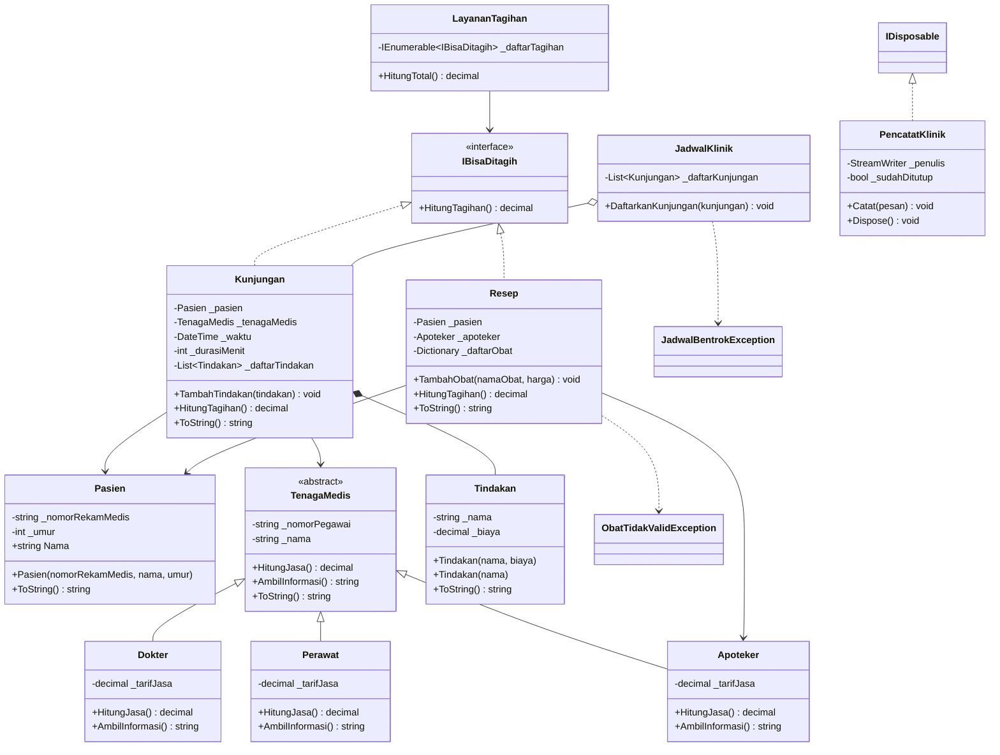

# Proyek ETS PBO — Klinik Mini

## Identitas

- Nama: Earlang Rangga Purwanto
- NRP: 5025251054
- Domain: Klinik Mini (sisa pembagian NRP dengan 6 adalah 2)

## Domain saya

Klinik Mini merupakan aplikasi sederhana untuk membantu pencatatan di klinik. Melalui aplikasi ini, pengguna bisa mencatat pasien, tenaga medis, kunjungan, dan resep obat, sekaligus menghitung biaya layanan. Aplikasi juga bisa menolak jadwal yang bentrok dan data obat yang tidak sesuai.

## Cara menjalankan

Jalankan perintah berikut dari folder utama repository:

```bash
dotnet build proyek/src
dotnet run --project proyek/src
```

Program akan menampilkan data tenaga medis, kunjungan pasien, resep obat, dan total tagihan. Selain itu, ada contoh penolakan jadwal yang bentrok dan data yang tidak valid.

## Diagram kelas



## Status kebutuhan

| ID | Kebutuhan | Status | Catatan |
|---|---|---|---|
| K1 | Enkapsulasi | selesai | Data disimpan dalam field `private` dan diperiksa melalui konstruktor atau method. Koleksi juga tidak dibuka sebagai `List` publik. |
| K2 | Komposisi dan pewarisan | selesai | `Dokter`, `Perawat`, dan `Apoteker` merupakan turunan `TenagaMedis`. `Kunjungan` dan `Resep` menggunakan objek dari class lain. |
| K3 | Polimorfisme | selesai | `HitungJasa()` dan `AmbilInformasi()` di-override pada class tenaga medis. Beberapa class juga memiliki override `ToString()`. |
| K4 | Abstract class dan interface | selesai | Menggunakan abstract class `TenagaMedis` dan interface `IBisaDitagih` yang diterapkan pada `Kunjungan` dan `Resep`. `LayananTagihan` menerima daftar tagihan melalui konstruktor. |
| K5 | Exception dan life cycle | selesai | Ada exception untuk jadwal bentrok dan obat tidak valid, penggunaan `try/catch/finally`, `IDisposable`, `using`, serta konstruktor berantai `: this(...)`. |
| K6 | Aplikasi berjalan | selesai | Build dan demo aplikasi sudah berhasil dijalankan. Program juga menampilkan contoh penanganan kesalahan. |
| Khas | Aturan khas domain | selesai | Jasa tenaga medis dihitung sesuai tarifnya, tagihan kunjungan dan resep dijumlahkan, jadwal bentrok ditolak, dan penambahan obat divalidasi. |
| Bonus | Bonus yang dikerjakan | sebagian | Diagram kelas menggunakan Mermaid sudah ditambahkan. Bonus lainnya belum dikerjakan atau belum diperiksa. |

## Yang belum selesai

Fitur utama Klinik Mini sudah bisa dijalankan. Namun, masih ada bonus yang belum dikerjakan, seperti unit test menggunakan xUnit dan penyimpanan data menggunakan JSON. Penggunaan `IComparable<T>` atau `IEquatable<T>` juga belum diterapkan. Riwayat commit perlu diperiksa lagi untuk memastikan jumlah dan tanggal commit sudah sesuai dengan ketentuan soal.
